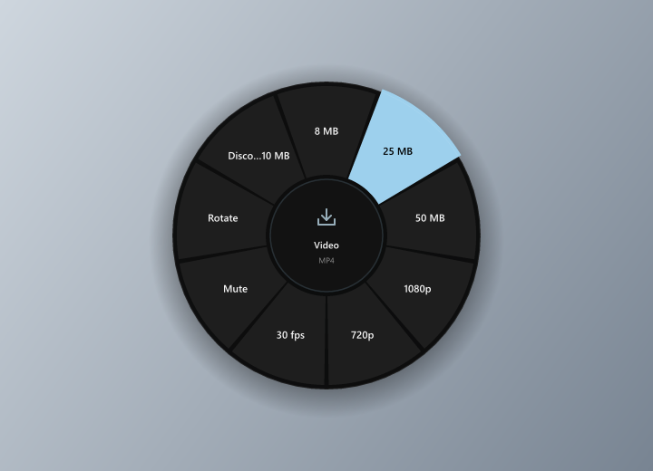
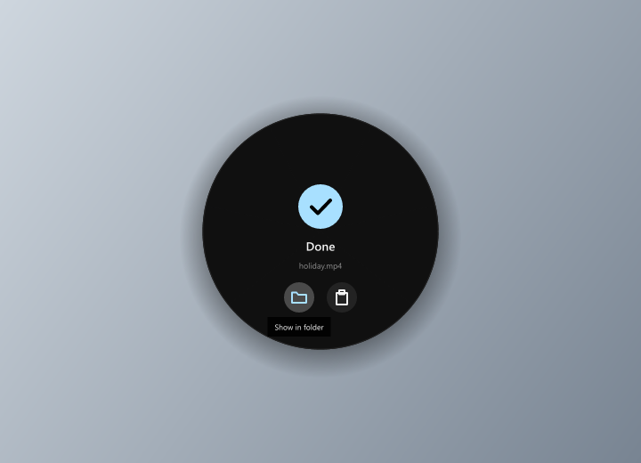
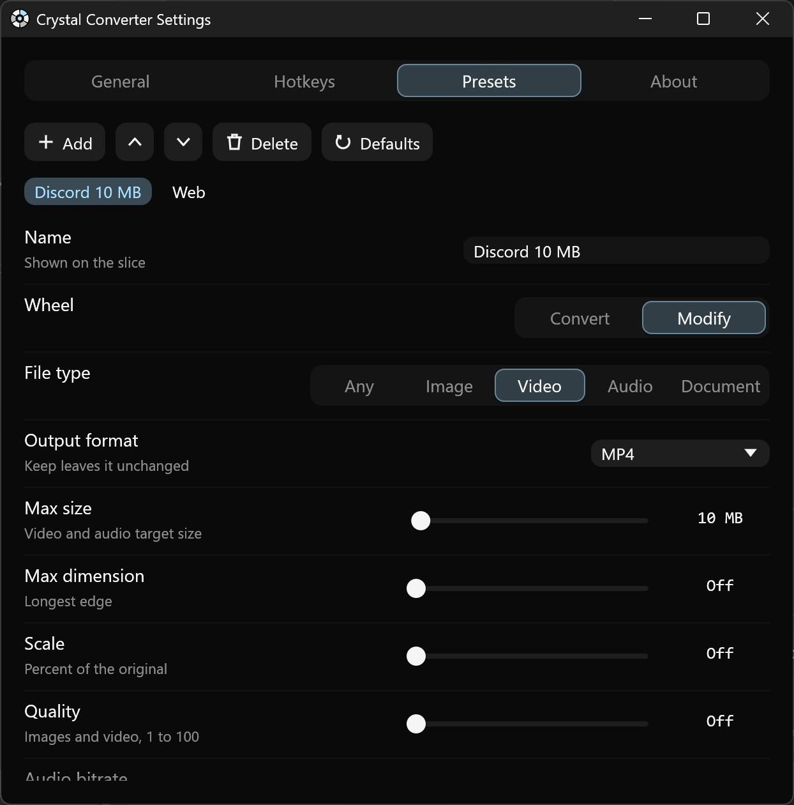
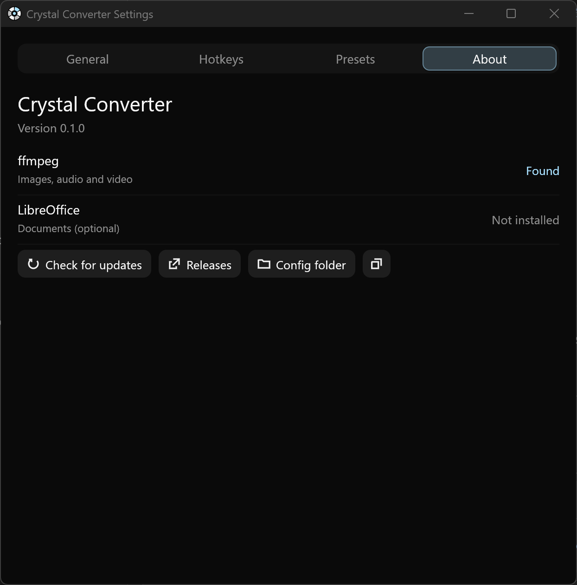

<p align="center"></p>

<p align="center">
  <a href="https://github.com/joezhuo2/crystal-converter/releases/latest"></a>
  <a href="https://github.com/joezhuo2/crystal-converter/releases"></a>
  <a href="https://github.com/joezhuo2/crystal-converter/actions/workflows/ci.yml"></a>
  
  <a href="https://www.rust-lang.org"></a>
  <a href="https://ffmpeg.org"></a>
  <a href="LICENSE"></a>
</p>

<p align="center">
  <a href="#download">Download</a> •
  <a href="#how-it-works">How it works</a> •
  <a href="#features">Features</a> •
  <a href="#formats">Formats</a> •
  <a href="#settings-and-keys">Keys</a> •
  <a href="#screenshots">Screenshots</a> •
  <a href="#files">Files</a> •
  <a href="#development">Development</a> •
  <a href="#license">License</a>
</p>

> Crystal Converter is a file converter for the Windows tray. Start dragging a
> file, hold a key, and a wheel opens in the middle of the screen. Drop the
> file on a slice to convert it, or drop it in the center and pick a format
> afterwards. A second key opens a wheel for changes that keep the format:
> shrink a video to 8 MB, resize an image, even out audio loudness and more.
> When it's done, the wheel shows you where the file went and closes itself.

<p align="center"></p>

## Download

Get the latest build from
[Releases](https://github.com/joezhuo2/crystal-converter/releases/latest):

- **`crystal-converter_x.y.z_x64.zip`** (recommended): the app with ffmpeg
  next to it. Unzip anywhere and run `crystal-converter.exe`. Nothing is
  installed.
- **`crystal-converter_x.y.z_x64.exe`**: the app alone. It uses an
  `ffmpeg.exe` next to it, one installed with winget, or one on your `PATH`.
  Settings > About has an **Install** button if none is found.

Windows 10 or 11, 64-bit.

### First launch

Crystal Converter is not code-signed yet, so SmartScreen says "Windows
protected your PC" the first time. Click **More info**, then **Run anyway**.
The builds come from the public [release workflow](.github/workflows/release.yml),
so you can check what went into them.

The first launch opens Settings so you can see the keys. After that the app
lives in the tray.

### Updates

The app checks GitHub 30 seconds after it starts (turn this off under
Settings > General). The tray menu then reads **Up to date (vX.Y.Z)** or
**Update found (vX.Y.Z)**; click the update item to open the release page.
**Check for updates** in the tray or Settings > About checks right away.
Nothing downloads or installs on its own.

## How it works

1. Start dragging a file (or several, or a folder) from Explorer, the
   desktop or any app that drags files.
2. While dragging, hold <kbd>`</kbd> for the **Convert** wheel or
   <kbd>Caps Lock</kbd> for the **Modify** wheel. As soon as you move the
   mouse, the slices fill in with the formats that fit the file you're
   holding.
3. Then either:
   - **drop on a slice** to start right away, or
   - **drop in the center**, let go of the key, and click a slice, or
   - **drop anywhere else** to cancel. Clicking outside the wheel also
     cancels.
4. The wheel collapses into one circle that shows each stage with its own
   animated icon: preparing, converting (with a progress ring when the length
   is known) and done. A sound plays when the job starts and when it
   finishes.
5. When it's done, the circle shows the file name with two icon buttons:
   **Show in folder** and **Copy to clipboard** (hover for their names). If
   you don't use them within 1.5 seconds, the circle closes. Hovering keeps it
   open.

The new file is saved next to the original. A name that's taken gets a
number, so nothing is overwritten.

## Features

- **Two wheels.** Convert changes the format. Modify keeps the format and
  changes size, quality or sound, and adds a suffix to the name, such as
  `clip-8-mb.mp4`.
- **Slices that fit the file.** The type is read from the file's first bytes,
  not only its extension. A batch of mixed files uses the most common type
  and leaves the others alone.
- **Batches and folders.** Drop several files or a folder; the circle counts
  through them. Several images to PDF become one multi-page PDF. Images and
  audio convert several files at once (Settings > General > Parallel files).
- **Queue.** Start another conversion while one is running (hold the key and
  drag, or use the Explorer menu); it waits its turn and the circle shows
  how many are waiting.
- **Time left and speed.** While converting, the circle shows the time left
  and ffmpeg's encode speed under the progress ring.
- **Clear errors.** A failed job shows a short reason with **Copy error** and
  **Open log** buttons. A batch reports `4 of 5 done, 1 failed`.
- **Estimated size.** Hovering a slice such as 8 MB shows the size to expect
  (`~7.2 MB`), or the new dimensions for a resize (`~960×540`).
- **Notifications.** A Windows notification appears when a job that took 10
  seconds or more finishes while the circle is closed or not always on top.
- **Stays out of the way.** ffmpeg runs at below-normal priority, and the PC
  stays awake until the job ends.
- **Replace original** (off by default) moves the source file to the Recycle
  Bin after a successful conversion. Nothing is deleted permanently, and a
  failed job or an empty result never touches the source.
- **Presets.** Add your own slices in Settings > Presets, for example
  "Discord 10 MB" (MP4 under 10 MB) or "Web" (WebP, 1920 px, quality 80).
  Each preset picks a wheel, a file type, an output format and any of the
  changes below.
- **Preset keys.** Give a preset a quick key in Settings > Presets. Press it
  while dragging a file and drop anywhere to run that preset with no wheel.
  The key is only taken while a mouse button is held.
- **Share presets.** Copy all presets as JSON or save them to a file, and
  import from a file or pasted text. Imports are checked first (unknown or
  wrongly typed fields are rejected) and are added to your list.
- **Custom ffmpeg arguments.** Each preset has an advanced field for extra
  ffmpeg arguments, for example `-preset slow -metadata "title=x"`. Quotes
  group words; the text is passed to ffmpeg as separate arguments, never
  through a shell, and `-i` is not allowed. Crystal Converter still sets the
  input and output files.
- **Copy to clipboard when done** (off by default) puts the results on the
  clipboard as files, ready to paste into Explorer, chat apps or email.
- **Open without dragging.** Select files in Explorer or on the desktop and
  press <kbd>Ctrl</kbd>+<kbd>Alt</kbd>+<kbd>Shift</kbd>+<kbd>E</kbd> to open
  the wheel for them.
- **Convert the clipboard.** <kbd>Ctrl</kbd>+<kbd>Alt</kbd>+<kbd>Shift</kbd>+<kbd>V</kbd>
  opens the wheel for copied files or a copied image, so a screenshot becomes
  PNG, JPG or WebP in one step.
- **Drops from browsers.** Drag an image or a link from Chrome or Edge onto
  the wheel. Only http and https links are downloaded (up to 100 MB), and only
  types the app can convert are kept.
- Results for clipboard images and browser drops are saved to your Pictures
  folder, or to the output folder if you set one.
- **Hardware encoding** uses NVIDIA NVENC, Intel Quick Sync or AMD AMF for
  MP4 when one works, and falls back to x264.
- **Fast remux.** MP4, MOV, MKV and M4V swap containers without re-encoding
  when no changes are asked for.
- **Explorer menu** (off by default): right-click a file and choose
  **Convert with Crystal Converter** (under Show more options on Windows 11)
  to open the wheel without dragging.
- **Tray icon.** Click it for Settings. Right-click for **Check for updates**,
  the update status, **Recent** conversions (click one to show it in
  Explorer), **Undo last conversion** (moves the new files to the Recycle
  Bin), **Open settings**, **Launch at login**, **Always on top** and
  **Quit**.
- **Low overhead.** When idle the app is a tray icon and a keyboard hook, with
  no window and nothing drawing: about 2 MB of private memory, a working set
  under 1 MB once settled, and no CPU.
  The wheel window is created when you press the key and destroyed when it
  closes. ffmpeg runs as a separate process only during a job. Settings is a
  separate process that exits when you close it.

## Formats

The Convert wheel leaves out the format the file already has.

| You drop | Convert to |
|---|---|
| Image (PNG, JPG, WebP, AVIF, BMP, TIFF, ICO, HEIC, SVG, TGA) | PNG, JPG, WebP, AVIF, GIF, ICO, BMP, PDF, Favicon |
| Animated GIF | MP4, WebM, WebP, PNG, JPG |
| Video (MP4, MOV, MKV, WebM, AVI, WMV, FLV, MPG, TS, 3GP) | MP4, WebM, MOV, MKV, AVI, GIF, WebP (animated), MP3, M4A, SRT (subtitles) |
| Audio (MP3, WAV, FLAC, OGG, Opus, M4A, AAC, WMA, AIFF) | MP3, WAV, FLAC, Opus, OGG, M4A |
| Document (DOC, DOCX, ODT, RTF, TXT, HTML) | PDF, DOCX, ODT, TXT, HTML, ZIP |
| Spreadsheet or slides (XLS, XLSX, ODS, CSV, PPT, PPTX, ODP) | PDF, ZIP |
| PDF | PNG, JPG (one image per page), DOCX, TXT (OCR), MERGE, ZIP |
| Markdown (MD) | HTML, PDF, ZIP |
| Archive (ZIP, 7Z, RAR, TAR, TGZ, GZ) | EXTRACT |

Images also get a TXT slice, and Video and Audio get ZIP.
| Video (MP4, MOV, MKV, WebM, AVI, WMV, FLV, MPG, TS, 3GP) | MP4, WebM, MOV, MKV, AVI, GIF, MP3, M4A |
| Audio (MP3, WAV, FLAC, OGG, Opus, M4A, AAC, WMA, AIFF) | MP3, WAV, FLAC, Opus, OGG, M4A, M4R |
| Document (DOC, DOCX, ODT, RTF, TXT, HTML) | PDF, DOCX, ODT, TXT, HTML |
| Spreadsheet or slides (XLS, XLSX, ODS, CSV, PPT, PPTX, ODP) | PDF |
| PDF | PNG, JPG (one image per page), DOCX |
| Several images | also **Slideshow**: one MP4, 3 seconds per image, in drop order |

PDF pages are rendered by Windows itself at twice their size. Everything
else in the Documents rows, and PDF to DOCX, needs
[LibreOffice](https://www.libreoffice.org). Settings > About
shows whether it's installed and has an **Install** button (through winget)
if not. Transparent images converted to JPG, BMP or PDF get a white
background.

- **TXT (OCR)** reads text from an image or a PDF with the OCR built into
  Windows, one TXT per file. It needs an OCR language installed (Windows
  Settings > Time & language > Language & region); the app says so if not.
- **MERGE** joins two or more dropped PDFs into one, in the order they
  were dropped. It handles ordinary PDFs with a classic cross-reference
  table, including incremental updates. Encrypted PDFs and PDFs that use
  compressed object or cross-reference streams (PDF 1.5 and later from some
  tools) are refused with an error. Bookmarks and form fields of the
  originals are dropped.
- **ZIP and EXTRACT** use the `tar.exe` that ships with Windows 10 and
  later. ZIP puts the dropped files in one `.zip`; EXTRACT unpacks an archive
  into a new folder next to it and refuses archives with paths that would
  land outside that folder.
- **Markdown to HTML or PDF** understands headings, emphasis, code, lists,
  links, images, quotes and tables, and escapes any raw HTML. PDF is printed
  by Microsoft Edge, which comes with Windows 11.

### Modify wheel

| File | Built-in slices |
|---|---|
| Image | Quality 75, 50%, 1920 px, 1080 px, No metadata, Rotate |
| Video | 8 MB, 25 MB, 50 MB, 1080p, 720p, 30 fps, Mute, Rotate, First 30 s, 2x speed, HDR to SDR, Thumbnail, Contact sheet |
| Image | Quality 75, 50%, 1920 px, 1080 px, No metadata, Rotate, Crop 1:1, 4:3, 16:9, 9:16, Grayscale, No GPS (JPG, PNG, WebP), Lossless (PNG) |
| Video | 8 MB, 25 MB, 50 MB, 1080p, 720p, 30 fps, Mute, Rotate |
| Audio | +6 dB, -6 dB, Normalize (−14 LUFS), Trim silence, Mono, 128 kbps |

Size targets work out a bitrate from the length of the file. A file that's
already under the target is re-encoded at normal quality instead. Presets can
combine any of: output format, max size, longest edge, scale, quality, audio
bitrate, frame rate, volume, rotation, loudness normalization, silence
trimming, mono, mute, stripping metadata and a trim start and end in seconds
(for example, a preset with start 10 and end 40 keeps that 30 second piece).
A wheel shows up to 16 slices.

Dropping several videos or several audio files adds a **Join** slice that
glues them together in drop order. Files with the same codecs and settings are
copied without re-encoding, anything else is re-encoded. Thumbnail saves one
frame as a JPG, Contact sheet a 4x3 grid of frames. HDR to SDR tone-maps
phone clips with zscale when your ffmpeg has it, and falls back to simpler
filters when it doesn't. SRT needs a text subtitle stream and says so if the
file has none.
trimming, mono, mute and stripping metadata. Presets can also fade, change speed (pitch kept), cut audio from a start time
for a set length, make images grayscale and remove only the GPS location.
A wheel shows up to 16 slices.

Notes on the image and audio slices:

- **Crop** is a centre crop to the ratio.
- **Favicon** writes one `.ico` holding 16, 32, 48, 64, 128 and 256 px
  versions, padded to a square with transparency.
- **Lossless** re-compresses a PNG with ffmpeg at the maximum zlib level; the
  pixels are identical and a result that isn't smaller keeps the original
  bytes. Gamma and colour profile chunks are dropped, and animated PNG is
  refused. Typical saving: 21% on one ffmpeg-made test image,
  little or nothing on PNGs that are already optimised.
- **No GPS** blanks the GPS block in the Exif of JPG, PNG and WebP files and
  keeps the rest. Other formats (HEIC, TIFF, ...) are refused rather than
  copied with their location. XMP copies of the location are not touched.
- **M4R** makes an iPhone ringtone (AAC in an MP4 container) cut to 40 s,
  the longest iOS accepts for ringtones.

## Settings and keys

| Key | Does |
|---|---|
| Hold <kbd>`</kbd> while dragging | Open the Convert wheel |
| Hold <kbd>Caps Lock</kbd> while dragging | Open the Modify wheel |
| Release the key before dropping | Close the wheel |
| <kbd>Esc</kbd> | Close the wheel, or cancel a running job |
| Right-click the wheel | Close it |

The keys only take effect while a mouse button is held, so typing <kbd>`</kbd>
or toggling Caps Lock works as usual the rest of the time. To change them,
open Settings > Hotkeys, click the key and press a new one; a reset button
appears next to a key that isn't the default. Shift, Ctrl, Alt and Win can't
be used because they change what a drag does (copy, move or shortcut).

Settings has four tabs:

- **General:** how long Done stays up, sounds, copy to clipboard when done,
  save next to the original or to a folder, hardware encoding, parallel
  files, replace original, launch at login, always on top, the Explorer menu and update checks.
- **Hotkeys:** the two keys.
  save next to the original or to a folder, hardware encoding, launch at
  login, always on top, the Explorer menu and update checks.
- **Hotkeys:** the two wheel keys, plus the Explorer selection and Clipboard
  hotkeys (the trash button turns one off).
- **Presets:** add, reorder, delete or restore presets, and edit each one.
- **Hotkeys:** the two keys.
- **Presets:** add, reorder, delete or restore presets, import and export
  them, and edit each one (including its quick key and ffmpeg arguments).
- **About:** version, whether ffmpeg and LibreOffice were found (with
  **Install** buttons), update check, the Releases page and the config
  folder.

Changes save as you make them, and the tray app picks them up right away.
The Settings window uses the same motion as
[crystal-design](https://crystal-design.vercel.app): smooth scrolling, animated
numbers, sliders that glide to where you click, spring switches, a gliding
tab indicator, and buttons whose icon turns into a check when they work.

## Screenshots

<p align="center">
  
  
</p>
<p align="center">
  
  
</p>
<p align="center">
  
  
</p>
<p align="center">
  
  
</p>

## Files

| Path | What |
|---|---|
| `%APPDATA%\crystal-converter\config.json` | Settings and presets. An unreadable file is kept as `config.json.bak` and defaults are used. |
| `%APPDATA%\crystal-converter\last-error.txt` | The full message from the last failed conversion (the **Open log** button). |
| `HKCU\Software\Microsoft\Windows\CurrentVersion\Run` → `Crystal Converter` | Only while Launch at login is on. |
| `HKCU\Software\Classes\*\shell\CrystalConverter` | Only while the Explorer menu is on. |

Turning those two options off removes their registry entries. Nothing else
is written outside the app folder and the files you convert.

## Development

You need Rust (stable, MSVC toolchain) and ffmpeg on your `PATH` or next to
the built exe.

```bash
cargo run
```

```bash
cargo test
```

```bash
cargo test -- --include-ignored
```

The last one also converts real test clips with your ffmpeg. Open a settings
tab directly with `cargo run -- --settings presets`, and open the wheel for a
file with `cargo run -- --open path\to\file`.

Regenerate the banner, icon, demo GIF frames and wheel screenshots (the
wheel renderer runs without a window):

```bash
cargo run --release --example render_frames -- target/frames
```

| File | Does |
|---|---|
| `src/app.rs` | Single instance, hidden host window, message loop, tray actions |
| `src/import.rs` | Explorer selection, clipboard and browser-drop import |
| `src/hook.rs` | Low-level keyboard hook; only reacts while a mouse button is down |
| `src/wheel.rs` | Layered window, OLE drop target, state machine, job thread |
| `src/render.rs` | tiny-skia drawing for the wheel, status circle and icon |
| `src/convert.rs` | ffmpeg arguments, progress, image-to-PDF writer, LibreOffice |
| `src/formats.rs` | File type detection, targets and built-in slices |
| `src/archive.rs`, `src/pdfmerge.rs`, `src/markdown.rs`, `src/ocr.rs` | tar zip and extract, PDF merging, Markdown to HTML, Windows OCR |
| `src/settings.rs` | egui settings window and its animated widgets |
| `src/tray.rs`, `src/update.rs`, `src/sys.rs` | Tray menu, update check, registry, clipboard, sounds |

Pushing a `v*` tag runs the [release workflow](.github/workflows/release.yml),
which builds the exe, bundles ffmpeg and creates a draft release.

## Contributing

Issues and pull requests are welcome. Run `cargo fmt`, `cargo clippy
--all-targets -- -D warnings` and `cargo test` before opening a pull request;
CI runs the same checks.

## License

[MIT](LICENSE). The release zip includes an ffmpeg build from
[gyan.dev](https://www.gyan.dev/ffmpeg/builds/), which is licensed under the
GPLv3; its license and source link are in `FFMPEG-LICENSE.txt` and
`FFMPEG-NOTICE.txt` in the zip.
